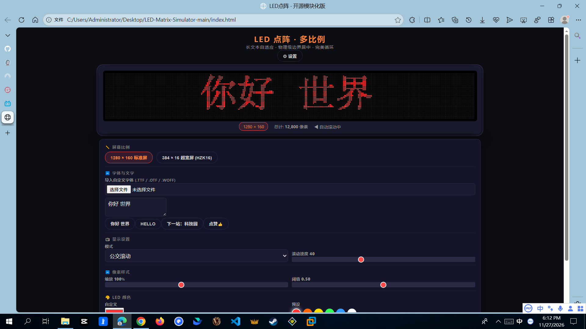
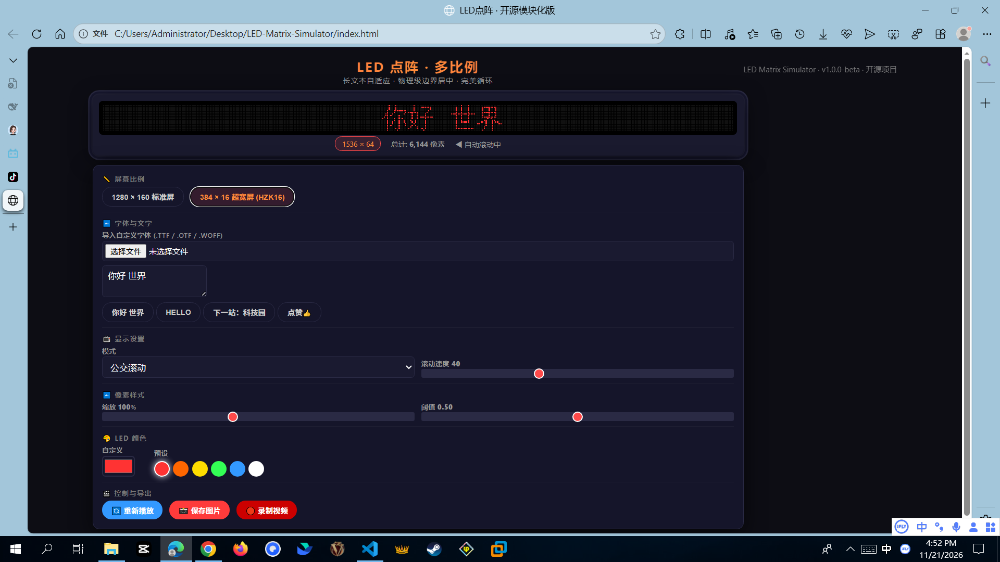

# LED-Matrix-Simulator
地铁公交LED点阵模拟器｜Subway & Bus LED Dot-Matrix Simulator

🔗 **在线体验 / Online Demo**：https://Zhou38551.github.io/LED-Matrix-Simulator/

## 📷 预览 / Screenshots

## ✨ 功能特性 / Features
- 双规格点阵屏：1280×160 标准大屏 / 384×16 HZK16窄屏
- Two screen sizes: 1280×160 standard screen / 384×16 HZK16 narrow screen
- 自定义文字、滚动速度、文字颜色
- Custom text, scroll speed and text color
- 一键导出PNG图片、录制屏幕视频
- One-click PNG export and video recording
- 纯前端实现，无需安装，浏览器直接运行
- Pure frontend, no installation required, run directly in browser
- 适合制作公交/地铁报站LED效果图
- Ideal for bus & subway LED destination sign preview
- - 地区预设设置面板，一键加载各地公交地铁LED模板
- Region setting panel, load regional transit LED templates with one click

## 📦 使用方式 / Usage
1. 在线：点上方链接直接打开
   Online: Click the link above to start
2. 本地：下载源码，双击 index.html 即可
   Local: Download source code, open index.html

## 📜 开源协议 / License
MIT License
